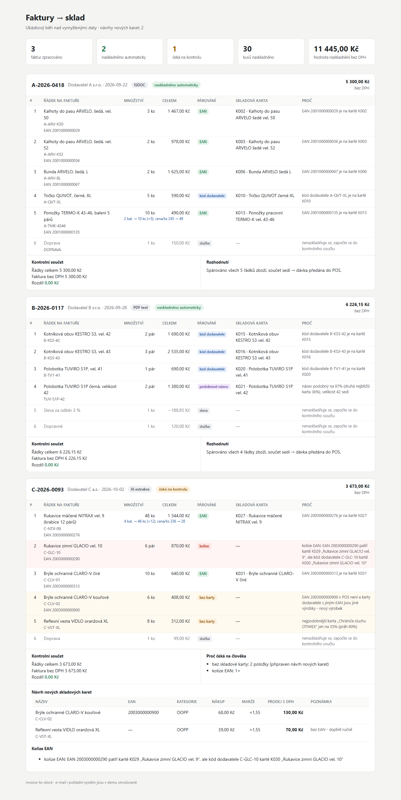
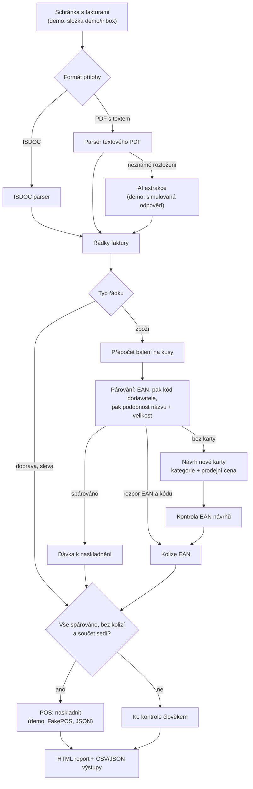

# invoice-to-stock

**Faktura od dodavatele přijde e-mailem a zboží je naskladněné v pokladně. Nikdo nic nepřepisuje.**

[English version below](#english)



## Pro majitele firem

### Problém

Každá dodávka znamená fakturu s desítkami řádků. Někdo je musí přepsat do pokladního systému:
dohledat skladovou kartu, hlídat velikosti, přepočítat „4 krabice“ na 48 párů rukavic, spočítat
prodejní cenu nového zboží a založit mu kartu. Zabere to čas a chyby (jiná velikost, krabice místo
kusů, stejný čárový kód na dvou kartách) se ukážou až u pokladny nebo při inventuře.

### Řešení

- **Přečte fakturu v běžných podobách.** Elektronickou fakturu ISDOC i PDF s textem; PDF, jehož rozložení
  nezná, přečte přes AI.
- **Ke každému řádku najde skladovou kartu a napíše proč.** Nejdřív podle čárového kódu (EAN), pak
  podle kódu dodavatele, nakonec podle podobnosti názvu, a vždycky s kontrolou velikosti.
- **Přepočítá balení na kusy** podle jednoduchého seznamu, který upravíte sami.
- **Zkontroluje součet** všech řádků proti celkové částce faktury.
- **Naskladní celou fakturu, nebo nic.** Pokud je cokoli nejasné, nenaskladní napůl. Připraví
  podklady ke kontrole: návrh nových karet s kategorií a prodejní cenou podle vašich pravidel marže
  a upozornění na kolize čárových kódů.

### Přínos

- Faktura, u které všechno sedí, je naskladněná bez lidské ruky.
- Člověk řeší jen výjimky a u každé vidí, co přesně je špatně.
- Sklad sedí na kusy a nákupní ceny odpovídají faktuře, protože se kontroluje každý řádek i celkový součet.
- Nové zboží dostane hotový návrh karty i prodejní ceny, stačí ho schválit. Ceny se zaokrouhlí na tvar,
  jaký zákazníci znají (699 místo 700).

### Z reálného provozu

Nasazeno v reálném provozu v maloobchodu s pracovními oděvy (2 firmy, desítky automatických úloh denně).
Toto repo je zjednodušená, samostatně spustitelná ukázka: všichni dodavatelé, zboží, čárové kódy i
ceny jsou vymyšlené a e-mail i pokladní systém jsou simulované.

**Chcete něco podobného pro svou firmu?** Napište mi: Jaroslav Velek, [jaravelin@gmail.com](mailto:jaravelin@gmail.com)

---

## Technická část

### Tok dat



### Moduly

| Modul | Co dělá |
|---|---|
| `isdoc.py` | ISDOC XML → faktura; namespace se čte z dokumentu, DTD/entity se odmítnou |
| `pdf_text.py` | textové PDF (pypdf, režim layout) → faktura; neznámé rozložení vyhodí `NeznamyFormat` |
| `ai_extrakce.py` | rozhraní `AiExtraktor`: `MockAiExtraktor` (offline) a `ClaudeExtraktor` (strukturovaný JSON výstup, jen s vlastním klíčem) |
| `parovani.py` | EAN → kód dodavatele → podobnost názvu; každý výsledek nese lidsky čitelný `duvod` |
| `baleni.py` | balení → kusy podle `config/baleni.json`; celkem za řádek se nemění |
| `ceny.py` | nákup × marže × DPH a zaokrouhlení do psychologických cen (pravidla v `config/pravidla.json`) |
| `kolize.py` | EAN návrhů nových karet: kontrolní číslice, už existuje na jiné kartě, duplicita v dávce |
| `navrh_karet.py` | návrh nové karty: kategorie podle slov v názvu, marže podle kategorie |
| `pipeline.py` | celý tok, typy řádků (zboží/služba/sleva), kontrolní součet, rozhodnutí „celá faktura, nebo nic“ |
| `pos.py` | rozhraní `POS` a `FakePOS` (stav v JSON, ochrana proti dvojímu naskladnění téhož dokladu) |
| `inbox.py` | složka místo e-mailové schránky; ISDOC má přednost před PDF téže faktury |
| `report.py` | HTML report z běhu |

Na čem demo ukazuje jednotlivé případy:

| Faktura | Vstup | Co ukazuje | Výsledek |
|---|---|---|---|
| `A-2026-0418` | ISDOC | párování přes EAN i kód dodavatele, balení 5 párů ponožek, doprava | naskladněno |
| `B-2026-0117` | textové PDF bez EAN | párování přes kód, podobnost názvu se změněným kódem, sleva 3 %, dopravné | naskladněno |
| `C-2026-0093` | PDF neznámého rozložení → AI | krabice 12 párů, chybný EAN od dodavatele (kolize), dva nové výrobky | ke kontrole |

### Spuštění

Potřebujete Python 3.10 nebo novější.

```bash
pip install -r requirements.txt
python -m invoice_to_stock demo
```

Demo vypíše přehled do konzole a zapíše do `demo/vystup/`:

- `davky/naskladneni_<faktura>.csv`: dávka pro POS (karta, množství, nákupní cena, jak a proč spárováno)
- `davky/navrh_naskladneni_<faktura>.csv`: totéž u faktury, která čeká na kontrolu (do POS nešla)
- `davky/nove_karty_<faktura>.csv`: návrhy nových skladových karet
- `davky/vysledek_<faktura>.json`: kompletní výsledek včetně kontrolního součtu a důvodů
- `pos_stav.json`: stav falešného POS po naskladnění
- `report.html`: report jako na obrázku nahoře

Hotové výstupy jednoho běhu jsou v [`docs/ukazkovy-vystup/`](docs/ukazkovy-vystup/).

### Testy

```bash
pip install -r requirements-dev.txt
python -m pytest
```

Testy pokrývají párování (včetně kolizí a nejednoznačných shod), přepočet balení, zaokrouhlení cen,
EAN, ISDOC/PDF/AI vstupy a celé demo end-to-end.

### Ukázková data a obrázek

```bash
python scripts/vygeneruj_demo_data.py      # katalog, ISDOC, PDF faktury (reportlab) a simulovaná odpověď AI
python scripts/screenshot_reportu.py       # docs/report.png (Playwright), bez metadat
```

Všechna data jsou vymyšlená. EAN jsou z interního rozsahu 200–299, který se pro skutečné zboží
nepoužívá, a mají platnou kontrolní číslici.

### Skutečná AI extrakce

`ClaudeExtraktor` posílá PDF do Claude API a vyžaduje odpověď jako JSON podle schématu (strukturovaný
výstup). Demo ho nevolá. Pro vlastní použití: `pip install anthropic`, nastavit `ANTHROPIC_API_KEY`
a v pipeline předat `ClaudeExtraktor()` místo `MockAiExtraktor`. Výstup AI prochází stejným párováním
a stejnou kontrolou součtu jako ISDOC, takže chybně přečtený řádek se nenaskladní.

---

<a id="english"></a>

# English

**A supplier invoice arrives by e-mail and the goods are in stock in the point-of-sale system.
No retyping.**

## For business owners

**The problem.** Every delivery comes with an invoice of dozens of lines. Someone has to retype them
into the POS: find the right product card, check sizes, convert "4 boxes" into 48 pairs of gloves,
work out a retail price for new items and create their cards. It takes time, and the mistakes
(wrong size, boxes instead of pieces, one barcode on two products) only show up at the till or
during stocktaking.

**The solution.**

- **Reads invoices in the usual forms:** ISDOC e-invoices and text PDFs. PDFs with an unknown layout are
  read by AI.
- **Matches every line to a product card and says why:** by barcode (EAN) first, then the supplier
  code, then name similarity, always with a size check.
- **Converts packs to pieces** using a simple list you maintain yourself.
- **Checks the total** of all lines against the invoice total.
- **Stocks the whole invoice or nothing.** If anything is unclear, it doesn't stock half of it.
  It prepares a review: proposed new product cards with category and retail price from your margin
  rules, plus barcode conflicts.

**The benefit.** Invoices where everything adds up are stocked with no human touch. People handle
only the exceptions, and each one comes with an explanation. Stock and purchase prices match the invoice.
New products get a ready-to-approve card proposal with a price rounded the way customers expect
(699, not 700).

**In production.** Deployed in real operation in workwear retail (2 companies, dozens of automated
jobs a day). This repository is a simplified, self-contained demo: all suppliers, products, barcodes
and prices are made up, and the e-mail inbox and POS are simulated.

**Want something similar for your business?** Contact Jaroslav Velek,
[jaravelin@gmail.com](mailto:jaravelin@gmail.com).

## Technical overview

The flow is shown in the diagram above. Code identifiers are in Czech, as in the production
original. A quick glossary: *faktura* = invoice, *položka/řádek* = line, *karta* = product card,
*párování* = matching, *balení* = pack, *naskladnění* = stock-in, *kolize* = conflict,
*návrh* = proposal, *ke kontrole* = needs review.

```bash
pip install -r requirements.txt
python -m invoice_to_stock demo        # processes demo/inbox, writes demo/vystup/ incl. report.html

pip install -r requirements-dev.txt
python -m pytest                       # matching, packs, pricing, EAN, ISDOC/PDF/AI inputs, end-to-end
```

- **Inputs:** ISDOC XML (`isdoc.py`), text PDF (`pdf_text.py`), and AI extraction behind an interface
  (`ai_extrakce.py`). The demo uses `MockAiExtraktor` with a recorded response. `ClaudeExtraktor` calls
  the Claude API with structured JSON output and is used only with your own API key.
- **Matching** (`parovani.py`): EAN, then supplier code (exact after normalisation), then name similarity
  with a size check. A card with a *different* EAN is never matched by name. If the EAN and the supplier
  code point to different cards, the line is a conflict and goes to review.
- **Rules live in config, not code:** margins per category, rounding zones, similarity threshold,
  service/discount keywords (`config/pravidla.json`), pack sizes (`config/baleni.json`). All values
  are illustrative.
- **Safety:** all-or-nothing stock-in, line check (qty × price = line total), invoice total check,
  barcode checks on proposed cards, and protection against stocking the same invoice twice.
- **Outputs:** stock-in batch (CSV/JSON for a generic POS), new card proposals, full JSON result,
  HTML report. Sample outputs are in [`docs/ukazkovy-vystup/`](docs/ukazkovy-vystup/).

## License

All rights reserved. The source is published for viewing only, see [LICENSE](LICENSE).
